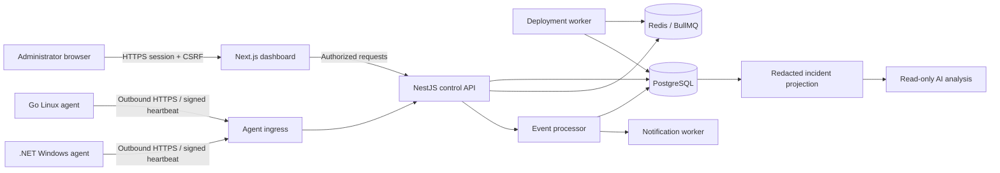

# Architecture and decision record

Status: identity/organization dashboard and Week 3 signed enrollment/heartbeat prototypes are implemented locally. Deployment workers, native firewall execution, event processing and AI remain planned.

## Boundaries and ownership

The API owns authentication, RBAC, tenant context, inventory, immutable policy versions, approvals and job state. The dashboard holds no server credentials and cannot execute agent operations directly. PostgreSQL is authoritative; Redis schedules work and can be rebuilt from persisted jobs/outbox records. Agent endpoints and user endpoints use distinct authentication guards and ingress policies. WebSockets initially deliver dashboard updates only; agents poll bounded jobs over outbound HTTPS so no inbound management port is needed.

Agents validate identity, signed job contents, expiration, monotonic policy versions, idempotency and local safeguards before any mutation. A privileged helper exposes a narrow allowlist (apply managed policy, inspect native state, rollback). No request may contain a shell command, script, executable path or arbitrary PowerShell fragment. The unprivileged transport component cannot directly modify the host firewall. The exact service account/capability model is a Week 3 VM-tested deliverable.

## ADR-001 — Monorepo with native agents

Use pnpm workspaces for TypeScript applications and packages. Go and .NET agents build and release independently. Share versioned JSON contracts and fixtures, not OS-specific firewall implementation. Go/.NET project files are deferred until their Week 3 prototypes. Week 2 implements the Next.js/NestJS identity and organization applications.

## ADR-002 — PostgreSQL and Prisma

Relational state supports approvals, transactional outbox, audit and tenant-scoped constraints. Use Prisma 6.19.0 as an explicit reproducible foundation baseline; this is not a claim that it is the newest release. Upgrade only with schema/migration regression review. PostgreSQL 17 is the development major. Schema changes are reviewed migrations; do not use `db push` in shared environments.

Composite foreign keys include organization ID on tenant-to-tenant edges. API queries additionally require active membership and tenant predicates. These foreign keys prevent mismatched parent links; they do not authorize SELECT queries. RLS is deferred until a tested request-scoped connection/transaction strategy exists. Before any shared pilot, perform cross-tenant read/write tests and use separate non-owner runtime and migration DB roles. Never claim that Prisma automatically enforces tenant isolation.

## ADR-003 — Durable asynchronous rollout

In one DB transaction, authorize the request, persist the approval/deployment decision, append audit records and insert outbox records. A worker publishes to BullMQ after commit. Outbox event ID is the queue deduplication key; database constraints and agent idempotency remain authoritative after queue loss. Expired leases are retried, with bounded attempts, exponential backoff and a dead-letter state. Jobs are never considered successful merely because enqueued or acknowledged.

Freeze target server IDs and version checksum at submission. Enforce one active deployment per server. Canary selection is explicit per OS/capability cohort; verify one server in each cohort before batched rollout. Any failed, unknown or rollback-failed canary pauses the deployment. Operator resume requires a new reviewed decision; do not silently skip failures.

## ADR-004 — Identity and secrets

Users: Argon2id password hashes, MFA enrollment/challenge, 15-minute access sessions and rotating single-use refresh tokens with 7-day absolute lifetime; cookie delivery uses HttpOnly, Secure and SameSite with CSRF protection. Token-family reuse revokes the family. Store refresh token hashes, never bearer values. Rate-limit login and enrollment. MFA secrets, if needed for TOTP, require KMS-backed envelope encryption; no ordinary plaintext DB field is provided.

Production agent target (superseded for the prototype by ADR-007 below): single-use 10-minute enrollment token, unique agent-generated private key, CSR and certificate issuance using a dedicated CA service. Keep CA private keys in a secret manager/HSM, not this database. Proposed certificate lifetime is 30 days with renewal starting at day 20; these CA/renewal mechanisms are not implemented by the signature-based prototype.

## ADR-005 — Policy safety

Immutable versions and content hashes bind preview, approval and jobs. PostgreSQL stores desired state; native adapter inspection produces observed state. Changes affect only ServerGuard-owned firewall objects. Unsupported host configurations fail validation. Protect configured management source networks and ports. A durable agent-local rollback watchdog survives transport loss and agent restart. See [policy semantics](firewall-policy.md).

## ADR-006 — Detection and AI separation

Events use a versioned normalized envelope with source-generated deduplication keys. Deterministic detection is reproducible without an LLM. AI consumes a redacted projection through a provider interface, has no control-plane write or agent credentials, and records model/config provenance. Treat log strings and model output as untrusted data. Provider egress is opt-in per organization.

## ADR-007 — Week 3 application-signed identity prototype

The implemented prototypes use per-agent P-256 SPKI keys and ECDSA SHA-256 DER signatures over exact HTTP bodies, method, path, UTC timestamp and random nonce. Remote transport requires normal HTTPS verification; explicit HTTP testing is limited to literal loopback IPs. This implements the original per-agent-identity option without introducing an unreviewed CA/CSR signer. It is not mTLS; the earlier certificate lifecycle is a future production design, not an implemented claim.

Enrollment atomically binds a hashed ten-minute token to one key/server/tenant after checking the issuing user's current active Owner/Admin authority. Same-key recovery of a lost response is idempotent until token expiry. Heartbeats use a durable increasing sequence, bounded clock skew and server receipt time. Local keys stay in private Linux files or Windows DPAPI CurrentUser state; both clients prevent concurrent state ownership. Thirty-day credential renewal is administrator-assisted re-enrollment with a fresh key in this prototype. See [protocol](agent-protocol.md) and [installation](agent-installation.md).

The agents are intentionally unprivileged heartbeat reporters: no privileged helper or firewall operation exists yet. The systemd/SCM artifacts do not imply tested installation on production hosts. Native jobs, signed upgrades, CA issuance/mTLS, automatic key rotation and actual Linux/Windows Server VM tests remain separate gates.

## Deployment and operations

Development Compose runs PostgreSQL and Redis. The working Week 2 dashboard/API run as local Node.js processes and default to embedded PostgreSQL when DATABASE_URL is unset. Application SQL uses a parameterized adapter interface; Prisma owns the schema and external migration workflow. Proposed pilot deploys API, dashboard and workers in containers behind TLS ingress with private DB/queue access. Logs must redact credentials, addresses where required, and raw security payloads. Planned retention deletes use bounded tenant/time-indexed batches; audit retention requires a separate restricted archival role. Production DB backups require off-host encrypted copies and measured restore drills.

Scale event storage from PostgreSQL to an indexed search projection only after measured ingestion/query pressure. OpenSearch must not become the source of truth for approvals or jobs. High availability, regional failover, capacity sizing and hosted/self-hosted packaging remain later operational design work.

## References

- [Prisma v6 relations](https://docs.prisma.io/docs/orm/v6/prisma-schema/data-model/relations)
- [Prisma v6 migration workflow](https://docs.prisma.io/docs/orm/v6/prisma-migrate/getting-started)
- [PostgreSQL row security behavior](https://www.postgresql.org/docs/17/ddl-rowsecurity.html)
