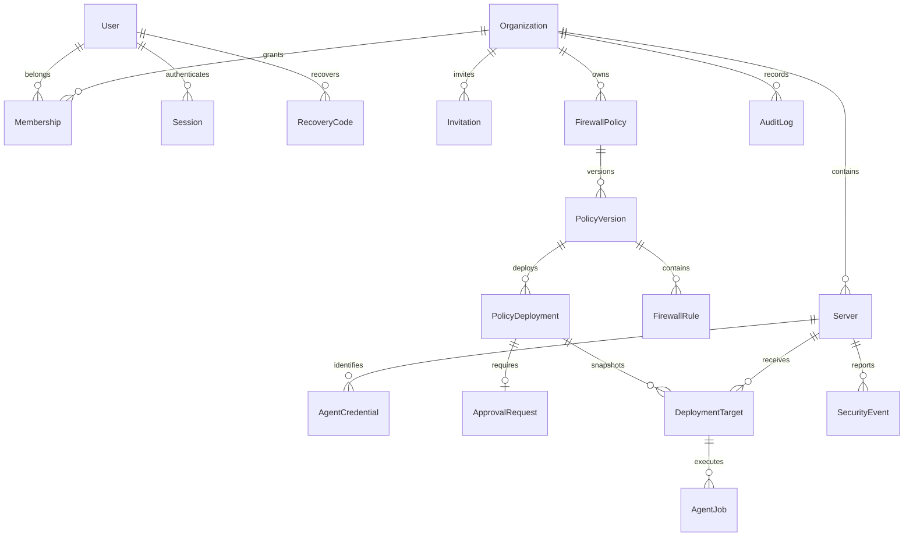

# Database design

Week 8 migration `202610290006_detections` extends the existing incident, notification, outbox and organization tables for deterministic detectors and durable IN_APP delivery; table count remains 24. See [detections](detections.md) for correlation/read-state/retention limits.

Week 7's additive `202610290005_rollouts` migration extends existing deployment/target/job structures with simulation mode, configuration, deadlines and evidence; it separates sandbox firewall state from actual server observed state. No new domain table is added (24 total). See [rollouts](rollouts.md).

Week 4 adds the 24th domain table, `metric_samples`, inventory architecture/logical CPUs, event-content hashes and composite tenant/server/credential binding. See [telemetry](telemetry.md). Earlier table counts describe historical foundation scope.

The canonical model is [schema.prisma](../infrastructure/database/schema.prisma). `202610290001_initial` creates the tables, enums, FKs and indexes. `202610290002_safety` adds checks and triggers not expressed by Prisma. Never regenerate the first migration after it has been applied. Add a new migration for later changes.

## Entity dictionary

| Table | Purpose / key invariants |
| --- | --- |
| organizations | Tenant identity and display name; deletion is not exposed. |
| users | Global login identity; normalized unique email, Argon2id hash, disabled timestamp and encrypted MFA state. |
| memberships | Composite organization/user primary key and OWNER/ADMIN/OPERATOR/VIEWER role. |
| sessions | Hashed access, refresh and CSRF credentials; rotation family, consumption/revocation and bounded expiry. |
| mfa_recovery_codes | Hashed single-use high-entropy codes with consumed timestamp. |
| invitations | Tenant, recipient email, role, hashed token, issuer and acceptance/revocation/expiry. |
| servers | Organization, OS, native capability summary, heartbeat, labels and observed policy state. |
| server_groups | Organization-scoped named groups. |
| server_group_members | Composite FKs ensure server and group belong to the same organization. |
| agent_credentials | Week 3 public SPKI key/fingerprint, replay sequence, expiry/revocation; optional certificate identity metadata for future mTLS. No private keys. |
| enrollment_tokens | Hashed server-bound one-key enrollment credentials, revocation, expiry and consumed credential linkage. |
| firewall_policies | Stable tenant-scoped policy identity. |
| policy_versions | Positive monotonic version, target definition, sealing timestamp and canonical content checksum. |
| firewall_rules | Version-bound network/traffic rules; native INET stores IPv4/IPv6 prefixes; canonical-network check rejects host bits. |
| policy_deployments | Desired version, frozen target checksum, requester and overall rollout state. |
| approval_requests | One approval per deployment; distinct approver and consistent decision fields. |
| deployment_targets | Frozen per-server rollout result, canary flag, error, verification and rollback metadata. |
| agent_jobs | Restricted operation vocabulary, idempotency key, bounded lifetime, lease, attempts and result. |
| security_events | Tenant/server-bound normalized event with source deduplication and occurrence/receive timestamps. |
| incidents | Correlated evidence and investigation lifecycle. |
| audit_logs | Tenant, actor, action, resource, request correlation, safe metadata and timestamp; append-only trigger. |
| notifications | Destination reference rather than secret, delivery state, retry scheduling and deduplication. |
| outbox_events | Durable transaction-to-queue publication records. |

## Relationships

## Enforcement responsibilities

Database: unique IDs/token hashes/emails, enum values, same-tenant parent references, port/protocol ranges, distinct requester/approver, sealed content protection and audit UPDATE/DELETE rejection. Sealed policy rules lock their version row before checking immutability to serialize with submission.

Application: membership/role checks on reads and writes, last-owner prevention under organization row lock, token consumption, approval authorization, valid state transitions, server capability and management-access checks. The current API implements only Week 2 identity/organization/session operations. No later policy rollout behavior is implied by schema existence.

Actor reference FKs ensure the identity exists, not that it currently belongs to the organization; authorization must check the action at execution time. Audit records retain former members. Hard deletion is deliberately restricted to avoid history loss. RLS is not configured; DB access must be confined to trusted services.

## Runtime adapters and migrations

`202610290003_agents` adds uptime, public-key identity, replay counters and token-to-credential linkage. Existing certificate fields become optional while a CHECK requires either a public-key identity or certificate metadata. The number of domain tables remains 23. Apply new migrations; do not rewrite already-applied earlier migrations.

Local default: persistent PGlite embedded PostgreSQL in `.runtime/postgres`. Its bootstrap applies the same SQL migrations transactionally and records SHA-256 migration checksums in `_serverguard_migrations`. One API process may own this directory at a time. Tests use a fresh in-memory database.

External PostgreSQL: set `DATABASE_URL`, deploy via Prisma Migrate and connect with a bounded `pg` pool. The API refuses startup if the expected tables are absent. Do not point embedded bootstrap at an external database. Prisma defines and migrates the schema; application queries are parameterized SQL through one adapter interface so the embedded and external engines share behavior. The generated Prisma client is available for future services, not used by the current HTTP handlers.

## Retention and access

Index tenant/event time and tenant/audit time; source keys deduplicate events. Retention targets are defined in requirements. No cleanup scheduler is implemented yet. Audit deletion needs a separately reviewed archival migration/job with controlled trigger handling and immutable off-host evidence; ordinary runtime credentials must not bypass the trigger. PostgreSQL administrators can alter triggers, so this is append-only application history, not cryptographic tamper-proof storage.

Development Compose uses a bootstrap owner for convenience. Before shared deployment create a distinct non-owner application role, grant minimum DML rights, revoke TRUNCATE/DDL, and keep migrations on a separate credential. Backups, replication, partitioning, RLS and production credential provisioning require operational validation.
